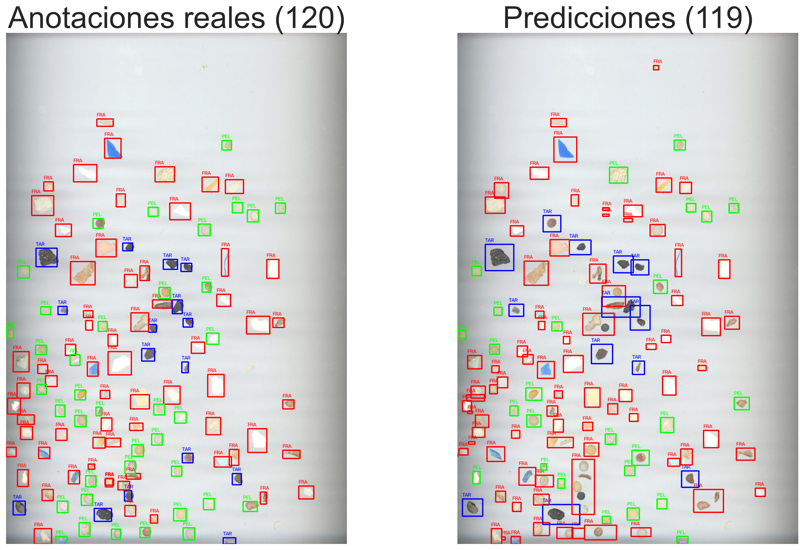
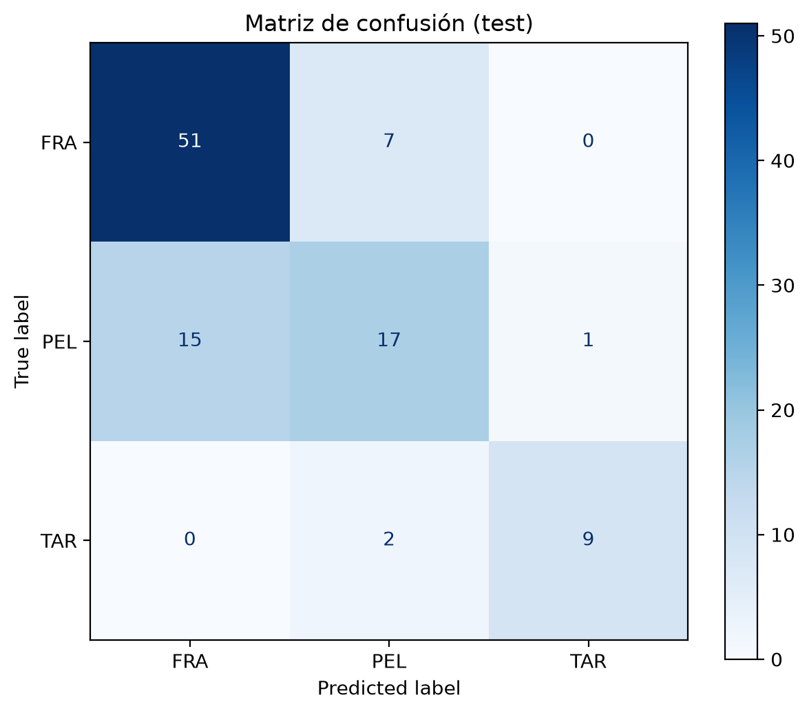

# Práctica 3 - Visión por Computador

Este repositorio contiene la tercera práctica de la asignatura Visión por Computador. Se trabaja con Python, OpenCV, NumPy, Pandas, Matplotlib, scikit-learn y SciPy para detectar objetos, extraer sus características geométricas y visuales y clasificarlos mediante técnicas clásicas de visión por computador.

La práctica se divide en dos tareas:

- **Tarea 1:** detección y clasificación de monedas de euro en una imagen fija y en tiempo real mediante una webcam, con estimación del valor total.
- **Tarea 2:** detección y clasificación de partículas de tres categorías, fragmentos plásticos (FRA), pellets (PEL) y alquitrán (TAR), mediante segmentación, extracción de características geométricas y visuales y un clasificador basado en distancias y reglas heurísticas.

## Autores

- [Pablo Llopis Parrilla](https://github.com/Putrici0)
- [David González Espino](https://github.com/002avid)

## Contenido del repositorio

- `VC_P3.ipynb`: cuaderno principal donde se desarrolla la práctica.
- `imagenes/monedas/`: imágenes utilizadas para la detección y clasificación de monedas.
- `imagenes/microplasticos/`: imágenes completas de entrenamiento, subimágenes de referencia y la imagen de prueba.
- `datos/MPs_test_bbs.csv`: anotaciones de referencia de la imagen de prueba, con las cajas delimitadoras y la clase de cada partícula.
- `resultados/`: carpeta donde se guardan las figuras generadas durante la práctica.

## Instalación y ejecución

No se necesita instalar nada adicional respecto al entorno indicado en el [README de la práctica 3 proporcionada por el profesor](https://github.com/otsedom/otsedom.github.io/blob/main/VC/P3/README.md). Con ese entorno es suficiente para ejecutar el cuaderno `VC_P3.ipynb`.

El cuaderno debe ejecutarse desde el directorio raíz del repositorio para que funcionen las rutas relativas a `imagenes/`, `datos/` y `resultados/`.

La primera tarea dispone de un modo de ejecución con webcam, por lo que se necesita una cámara disponible y permisos para acceder a ella. La segunda tarea utiliza las imágenes y anotaciones almacenadas en el repositorio.

## Tarea 1. Detección y clasificación de monedas

Para esta tarea se ha realizado una primera implementación que procesa la imagen `imagenes/monedas/Monedas.jpg` y estima el valor total de las monedas detectadas. El procedimiento se basa en detectar contornos, filtrar los que pueden corresponder a monedas, calibrar la escala utilizando una moneda de referencia y comparar los diámetros estimados con los oficiales. Además, posteriormente se realiza otra implementación aplicando un procedimiento similar pero para las imágenes de un vídeo en tiempo real.

### 1.1. Carga, bordes y contornos

Se carga la imagen, se convierte a escala de grises y se detectan sus bordes mediante Canny:

```python
img = cv2.imread("imagenes/monedas/Monedas.jpg")

if img is None:
    raise FileNotFoundError(
        "No se ha podido cargar imagenes/monedas/Monedas.jpg"
    )

gris = cv2.cvtColor(img, cv2.COLOR_BGR2GRAY)
bordes = cv2.Canny(gris, 30, 150)

kernel = np.ones((5, 5), np.uint8)
bordes = cv2.morphologyEx(
    bordes, cv2.MORPH_CLOSE, kernel, iterations=2
)

contornos, _ = cv2.findContours(
    bordes, cv2.RETR_EXTERNAL, cv2.CHAIN_APPROX_SIMPLE
)
```

`cv2.imread()` carga la imagen desde la ruta indicada. Si no se encuentra o no puede abrirse, devuelve `None`, por lo que se lanza una excepción para evitar continuar con una imagen inexistente. La conversión a escala de grises simplifica el procesamiento, ya que la detección de bordes no necesita trabajar con los tres canales de color.

En `Canny(gris, 30, 150)`, `30` es el umbral inferior y `150` el superior. Estos valores determinan qué cambios de intensidad se consideran bordes. Un umbral inferior más reducido permite conservar bordes más débiles, mientras que el superior ayuda a identificar los bordes más marcados. Esta configuración permite detectar mejor los límites de las monedas en la imagen utilizada.

El cierre morfológico (`MORPH_CLOSE`) utiliza un kernel de `5 × 5` y dos iteraciones para unir pequeñas interrupciones en los bordes. Después, `RETR_EXTERNAL` recupera únicamente los contornos exteriores, evitando procesar los contornos internos como candidatos independientes.

### 1.2. Filtrado de candidatos

No todos los contornos detectados corresponden a monedas. Para reducir los falsos positivos, se descartan aquellos con un área demasiado pequeña o demasiado grande y se comprueba su circularidad:

```python
area_img = alto_img * ancho_img

for c in contornos:
    area = cv2.contourArea(c)
    perimetro = cv2.arcLength(c, True)

    if perimetro == 0:
        continue

    if area < area_img * 0.0002 or area > area_img * 0.20:
        continue

    circularidad = (4 * np.pi * area) / (perimetro ** 2)

    if circularidad < 0.70:
        continue

    centro, radio = cv2.minEnclosingCircle(c)
    diametro_px = radio * 2
```

Los límites `0.0002` y `0.20` representan, respectivamente, el `0,02 %` y el `20 %` del área total de la imagen. El primero elimina regiones diminutas que pueden corresponder a ruido, mientras que el segundo descarta regiones excesivamente grandes.

La circularidad se calcula mediante la expresión `4π · área / perímetro²`. Un círculo ideal tiene una circularidad próxima a `1`, mientras que las formas irregulares presentan valores inferiores. El umbral `0.70` permite conservar contornos aproximadamente circulares sin aceptar demasiadas formas que se alejen de la geometría de una moneda. La comprobación de que el perímetro no sea cero evita una división indefinida.

Para cada candidato que supera estos filtros, `minEnclosingCircle()` calcula el círculo mínimo que contiene el contorno. A partir de su radio se obtiene el diámetro en píxeles, que se almacena junto con el contorno y las coordenadas de su centro.

### 1.3. Selección de la moneda de referencia y calibración

Como el diámetro en píxeles depende del tamaño y de la resolución de la imagen, es necesario convertirlo a una medida física. Para ello, el programa muestra los candidatos numerados y permite seleccionar una moneda cuyo valor se conozca:

```python
diametros_euro = {
    0.01: 16.25, 0.02: 18.75, 0.05: 21.25, 0.10: 19.75,
    0.20: 22.25, 0.50: 24.25, 1.00: 23.25, 2.00: 25.75
}

indice_ref = int(input(
    "\nNúmero de la moneda de referencia: "
)) - 1

diametro_ref = candidatos[indice_ref]["diametro_px"]

valor_ref = float(input(
    "Valor de la moneda (0.01, 0.02, 0.05, 0.10, "
    "0.20, 0.50, 1 o 2): "
).replace(",", "."))

mm_por_pixel = diametros_euro[valor_ref] / diametro_ref
```

El diccionario `diametros_euro` contiene los diámetros oficiales de las ocho denominaciones, expresados en milímetros. El usuario selecciona el número de una moneda detectada e introduce su valor, admitiendo tanto el punto como la coma decimal.

La escala se obtiene dividiendo el diámetro oficial de la moneda de referencia entre su diámetro estimado en píxeles:

`mm_por_pixel = diámetro oficial / diámetro en píxeles`

Por ejemplo, si una moneda de referencia tiene un diámetro oficial de `20 mm` y se detecta con un diámetro de `200 píxeles`, la escala sería de `0,1 mm/píxel`. A partir de ese momento, todos los diámetros detectados se pueden expresar en milímetros multiplicándolos por dicha escala.

La calibración debe realizarse con una moneda bien detectada y situada en el mismo plano que las demás. Una referencia mal seleccionada, una medición imprecisa o los efectos de la perspectiva pueden introducir errores en la clasificación de todas las monedas.

### 1.4. Clasificación por diámetro

Una vez calculada la escala, el programa compara el diámetro estimado de cada candidato con los diámetros oficiales:

```python
tolerancia_mm = 1.5
denominaciones_euro = list(diametros_euro.keys())

for c in candidatos:
    diametro_mm = c["diametro_px"] * mm_por_pixel

    valor_probable = None
    error_minimo = float("inf")

    for valor in denominaciones_euro:
        error = abs(diametros_euro[valor] - diametro_mm)

        if error < error_minimo:
            error_minimo = error
            valor_probable = valor

    color = (0, 0, 255)
    etiqueta = "Inicial"

    if error_minimo <= tolerancia_mm:
        total += valor_probable
        clasificadas += 1
        color = (0, 200, 0)
        etiqueta = f"{valor_probable:.2f} EUR"
```

Para cada moneda, se calcula primero el diámetro en milímetros. Después se recorren las ocho denominaciones y se calcula el error absoluto entre el diámetro estimado y el diámetro oficial de cada una. Se selecciona como candidata la denominación con el menor error.

La tolerancia `1.5 mm` establece el error máximo permitido para aceptar una clasificación. Si la diferencia entre el diámetro estimado y el oficial más cercano no supera ese valor, se acepta la denominación, se incrementa el contador de monedas clasificadas y se añade su valor al total. Si el error es superior, la moneda no debería contabilizarse.

Este método es sencillo y permite clasificar monedas sin recurrir a técnicas de aprendizaje automático. Sin embargo, tiene una limitación importante: algunas denominaciones tienen diámetros relativamente próximos, por lo que los errores de detección o calibración pueden provocar confusiones.

### 1.5. Visualización de los resultados

El programa muestra primero una imagen con los candidatos numerados para facilitar la selección de la moneda de referencia. Tras la calibración y la clasificación, vuelve a mostrar la imagen con las denominaciones estimadas y el total calculado:

```python
cv2.drawContours(vista, [c["contorno"]], -1, color, 2)

cv2.putText(
    vista, etiqueta, (c["x"] - 35, c["y"]),
    cv2.FONT_HERSHEY_SIMPLEX, 0.5, color, 2
)

cv2.putText(
    vista, f"Total: {total:.2f} EUR", (10, 30),
    cv2.FONT_HERSHEY_SIMPLEX, 0.8, (0, 255, 0), 2
)
```

`drawContours()` dibuja el contorno de cada moneda y `putText()` añade su denominación junto a ella. El color verde utilizado en OpenCV se representa mediante `(0, 200, 0)` para las monedas clasificadas. El total se muestra con dos decimales mediante el formato `:.2f`, lo que permite presentar el resultado en euros.

Finalmente, se imprime un resumen con el número de monedas detectadas y el valor total estimado. Es importante distinguir entre el número de candidatos detectados y el número de monedas correctamente clasificadas: detectar un contorno no garantiza que su denominación se haya podido determinar de forma fiable.

### Consideraciones y limitaciones

El resultado depende de la calidad de los contornos, de la selección de la moneda de referencia y de la tolerancia utilizada. La iluminación, las sombras, los reflejos y la perspectiva pueden alterar las medidas estimadas. Asimismo, el uso exclusivo del diámetro limita la capacidad de distinguir denominaciones con tamaños similares. Aún así, como se puede comprobar en la siguiente imagen, los resultados son muy positivos.


### 1.6. Webcam: funcionamiento en tiempo real

La segunda implementación realiza la detección y clasificación de monedas a partir de los fotogramas capturados por la webcam. A diferencia de la imagen fija, el procesamiento se repite continuamente y permite visualizar cómo cambia el resultado cuando se mueven las monedas.

#### 1.6.1. Captura y detección en vídeo

La cámara se abre mediante `cv2.VideoCapture(0)` y el programa procesa cada fotograma dentro de un bucle:

```python
vid = cv2.VideoCapture(0)

while True:
    disponible, img = vid.read()

    if not disponible:
        print("No se ha podido leer el fotograma.")
        break

    gris = cv2.cvtColor(img, cv2.COLOR_BGR2GRAY)
    bordes = cv2.Canny(gris, 25, 120)
```

`vid.read()` devuelve un indicador que permite comprobar si se ha obtenido correctamente el fotograma. Si la captura falla, el programa termina el bucle. Para el vídeo se utilizan los umbrales `25` y `120` en Canny, en lugar de `30` y `150`, empleados en la imagen fija. El resto del proceso de detección y filtrado de contornos mantiene el mismo planteamiento que en el apartado anterior.

#### 1.6.2. Calibración interactiva

La principal diferencia respecto a la imagen fija es que la referencia se selecciona directamente sobre el vídeo. Antes de calibrar, los candidatos se muestran numerados para poder elegir uno de ellos:

```python
if not calibrado:
    for i, c in enumerate(candidatos):
        cv2.drawContours(
            vista, [c["contorno"]], -1, (0, 255, 0), 2
        )
        cv2.putText(
            vista, str(i + 1), (c["x"], c["y"]),
            font, 0.8, (0, 0, 255), 2
        )
```

El procedimiento consiste en pulsar una tecla del `1` al `9` para seleccionar la moneda de referencia e introducir su valor en la consola. Con el diámetro detectado y el diámetro oficial correspondiente se calcula la escala en milímetros por píxel, igual que en la imagen fija.

Las variables `calibrado` y `mm_por_pixel` controlan este proceso. Mientras `calibrado` sea `False`, se muestran los candidatos numerados; una vez establecida la escala, comienza la clasificación automática de los fotogramas posteriores.

#### 1.6.3. Clasificación y actualización del resultado

Una vez calibrado el sistema, cada fotograma se clasifica utilizando los diámetros oficiales y la tolerancia de `1.5 mm` explicados en el apartado anterior. El total y el número de monedas clasificadas se inicializan de nuevo en cada iteración:

```python
total = 0.0
clasificadas = 0

for c in candidatos:
    diametro_mm = c["diametro_px"] * mm_por_pixel
```

Esto significa que el importe mostrado corresponde a las monedas detectadas y clasificadas en el fotograma actual. **No se acumula el dinero a lo largo del vídeo**: si una moneda deja de aparecer en la imagen, deja de contribuir al total.

La ventana muestra el importe estimado, el número de candidatos detectados y el número de monedas clasificadas. De esta forma, se puede comprobar en tiempo real si todas las monedas visibles se están detectando y cuántas han superado el criterio de clasificación.

Al igual que en la imagen fija, la clasificación se basa exclusivamente en el diámetro. Por tanto, las monedas con tamaños similares pueden confundirse y los errores de calibración pueden afectar a los resultados.

#### 1.6.4. Controles y recalibración

El programa permite controlar la ejecución mediante el teclado:

- **Teclas del `1` al `9`:** seleccionan la moneda de referencia antes de calibrar.
- **`C`:** reinicia la calibración para seleccionar una nueva referencia.
- **`ESC`:** finaliza la ejecución y cierra la cámara y las ventanas.

La recalibración resulta útil si cambian las condiciones de captura, aunque para obtener medidas fiables las monedas deben permanecer aproximadamente en el mismo plano y a la misma distancia de la cámara que la referencia. Si se acercan o se alejan, su diámetro en píxeles cambia y la escala calculada puede dejar de ser válida.

### Resultado en tiempo real


## Tarea 2. Detección y clasificación de partículas

La imagen de prueba es `imagenes/microplasticos/MPs_test.jpg`; las cajas y etiquetas reales se encuentran en `datos/MPs_test_bbs.csv`. Se distinguen `FRA` (fragmentos), `PEL` (pellets) y `TAR` (alquitrán, clase que aparece en los datos aunque no sea un microplástico propiamente dicho).

El clasificador es una implementación propia basada en distancias ponderadas a muestras etiquetadas, que promedia las tres muestras más cercanas de cada clase y después aplica reglas heurísticas de color y forma para revisar algunos casos.

### 2.1. Segmentación: crear una máscara de partículas

La función `detectar()` crea varias máscaras para encontrar partículas claras, oscuras o de color distinto al fondo. Primero compara una versión suavizada con una estimación más amplia del fondo:

```python
gris = cv2.cvtColor(imagen, cv2.COLOR_BGR2GRAY)
suave = cv2.GaussianBlur(gris, (5, 5), 0)
fondo = cv2.GaussianBlur(gris, (51, 51), 0)
claras = cv2.subtract(suave, fondo)
oscuras = cv2.subtract(fondo, suave)
```

El filtro `5 × 5` conserva los detalles locales; el de `51 × 51` genera un fondo mucho más suave. `suave - fondo` resalta zonas más claras que el entorno, mientras que `fondo - suave` resalta las más oscuras. En ambas diferencias se calcula un umbral con Otsu y se impone un mínimo de `8.5`, para no aceptar cambios de intensidad muy pequeños.

Se añaden otras dos máscaras: una basada en diferencias de saturación HSV y otra basada en la distancia entre el color LAB de cada píxel y una estimación del fondo local. En la máscara LAB, una distancia superior a `10` se considera diferencia de color. Las cuatro máscaras se combinan mediante OR y se aplica un cierre pequeño:

```python
mascara = cv2.bitwise_or(
    cv2.bitwise_or(m1, m2),
    cv2.bitwise_or(m3, m4)
)
mascara = cv2.morphologyEx(
    mascara, cv2.MORPH_CLOSE,
    cv2.getStructuringElement(cv2.MORPH_ELLIPSE, (3, 3))
)
```

La unión permite que una partícula se detecte por contraste claro/oscuro o por color. El kernel elíptico de `3 × 3` cierra pequeños huecos, intentando no unir partículas vecinas. Después se extraen contornos externos. Los valores `51`, `20` y `10` controlan la escala de comparación con el fondo y la sensibilidad de las máscaras; afectan directamente a qué regiones se detectan.

### 2.2. Separar partículas que se tocan

Un contorno puede contener varias partículas pegadas. `separar_grupos()` solo intenta dividir contornos con área de al menos `350 px²` y ancho y alto de al menos `22 px`. Calcula la transformada de distancia, donde los valores altos se encuentran en el interior de cada objeto, y selecciona núcleos por encima de `max(3, 0.52 * maximo)`. Se descartan núcleos de menos de `7` píxeles y solo se intenta dividir si aparecen entre 2 y 6 centros. Los píxeles se asignan al centro más cercano y la división se acepta si las nuevas regiones conservan más del `65 %` del área original.

Hay una segunda función, `separar_alargados()`, para grupos grandes y alargados que no se separaron en la primera pasada. Solo considera contornos con área de al menos `400 px²`, caja de al menos `1500 px²` y relación entre lado largo y corto de `1.8` o más. Busca máximos locales usando una ventana de `13 × 13`, exige una distancia mínima de `12 px` entre centros y acepta la división si conserva al menos el `70 %` del área. Estos límites son deliberadamente conservadores: se busca separar grupos evidentes sin fragmentar objetos normales.

### 2.3. Características: representar cada contorno con números

La función `caracteristicas()` convierte cada partícula en un vector de **20 valores**. Antes, descarta contornos con área menor que `20 px²`, mayor que `5000 px²` o perímetro cero. En entrenamiento también elimina los que tocan el borde; en test se permite conservarlos salvo los demasiado pequeños, porque una partícula puede quedar cortada por el encuadre.

Las primeras características describen la forma:

```python
return [p*p/(4*np.pi*a), a/(w*h), min(w, h)/max(w, h),
        relacion_ejes, regularidad, a/hull if hull else 0,
        # ... características de brillo y color
]
```

`p*p/(4πa)` es la compacidad: vale cerca de `1` para un círculo ideal y aumenta con formas más irregulares. `a/(w*h)` mide qué proporción de su rectángulo ocupa el contorno. `min(w,h)/max(w,h)` se acerca a `1` en formas cuadradas o compactas y disminuye en formas alargadas. `relacion_ejes` procede de la elipse ajustada; `regularidad` compara las distancias de los puntos del contorno al centro; `a/hull` compara el área con la envolvente convexa.

El resto del vector mide apariencia: brillo relativo respecto al anillo de fondo cercano, saturación y variación de intensidad; tono y fracción de píxeles con color; diferencias de los canales `a` y `b` del espacio LAB entre partícula y fondo; medianas de color; y proporciones de tonos crema/beige y amarillos. Se usan tanto forma como color porque un pellet puede ser compacto y claro, mientras que un fragmento suele tener una forma más irregular. Las diferencias respecto al fondo ayudan a reducir la dependencia de la iluminación general.

### 2.4. Entrenamiento y algoritmo de clasificación

Las muestras de referencia se extraen de las imágenes de entrenamiento de cada clase y de sus subimágenes. Las imágenes completas se reducen a `25 %` del ancho y alto (`fx=.25`, `fy=.25`) con `INTER_AREA`, lo que reduce el coste del procesamiento. Cada contorno válido aporta un vector de características y una etiqueta `FRA`, `PEL` o `TAR`.

El clasificador principal se implementa en `predecir_distancia()`. **No es Random Forest, SVM ni un `KNeighborsClassifier` de scikit-learn**: calcula manualmente distancias ponderadas entre el vector nuevo y todos los vectores de entrenamiento:

```python
pesos = np.array([1,1,1,1,1,1,2,2,2,0,0,0,0,0,0,0,0,0,0,0])
media = Xref.mean(axis=0)
desv = Xref.std(axis=0) + 1e-6
A = (Xref - media) / desv
B = (Xnuevo - media) / desv

for f in B:
    dist = np.sqrt(np.sum(pesos * (A - f)**2, axis=1))
    d = {c: np.mean(np.sort(dist[yref == c])[:3]) for c in clases}
    pred.append(min(d, key=d.get))
```

La estandarización resta la media y divide por la desviación típica de cada característica, para que magnitudes distintas sean comparables. Se suma `1e-6` a la desviación para evitar divisiones por cero. Los pesos `1` dan importancia normal a las seis características geométricas iniciales; los pesos `2` duplican la contribución de brillo relativo, saturación y variación de intensidad; los pesos `0` dejan fuera del cálculo de distancia las características restantes, que se aprovechan en las reglas heurísticas posteriores. Para cada clase se calcula la media de las **tres distancias más pequeñas** y se asigna la clase con menor media. Esto reduce la dependencia de una sola muestra de referencia.

Después, `predecir_material()` corrige algunos resultados usando reglas de color y forma basadas en percentiles de las muestras `PEL` y `TAR`. Por ejemplo, puede asignar `TAR` si el brillo relativo es bajo y la señal amarilla es inferior al percentil 20 de pellets. Puede asignar `PEL` cuando las señales amarilla y beige, el relleno del rectángulo, la compacidad y el brillo cumplen los límites aprendidos de las muestras. Si la forma parece un fragmento irregular, evita convertirlo en pellet salvo que el color de pellet sea suficientemente fuerte.

Los parámetros finales son `seleccion = (50, 65)`, que se pasan a `fuerza_fra` y `proteccion_pel`. `50` selecciona percentiles intermedios para los límites de irregularidad y relleno usados al detectar fragmentos; `65` exige una evidencia de color más alta para proteger pellets claros de ser reclasificados como fragmentos. Son reglas heurísticas, no hiperparámetros de Random Forest. El código indica que se eligieron previamente con las imágenes de entrenamiento; las etiquetas del CSV de test solo se consultan después de obtener las predicciones.

### 2.5. Evaluación: emparejar detecciones con las anotaciones

La evaluación compara las cajas detectadas con las cajas del CSV. Para cada pareja calcula IoU (*Intersection over Union*): área de intersección dividida por área de unión. Una pareja se considera coincidente si `IoU >= 0.30`.

```python
umbral_iou = 0.30
recompensa = np.where(solapes >= umbral_iou, 2.0 + solapes, 0.0)
filas, cols = linear_sum_assignment(-recompensa)
```

La asignación húngara (`linear_sum_assignment`, de SciPy) empareja cajas sin reutilizar una misma detección o anotación. Las parejas por debajo de `0.30` reciben recompensa cero; las válidas reciben `2 + IoU`, de modo que se prioriza obtener el máximo número de coincidencias válidas y, después, un mayor solapamiento. Solo después de emparejar se comparan las etiquetas reales y predichas para calcular las métricas de clasificación. Así se distinguen errores de detección de errores de clase.

### Resultados de test

En la ejecución registrada, el sistema encontró **119 detecciones** frente a **120 partículas anotadas**. Se emparejaron **102 detecciones** con anotaciones y **77** de esas parejas tenían la clase correcta. La exactitud entre las parejas es `77/102 = 75,5 %`; si se cuentan también como fallos las partículas reales no emparejadas, el acierto respecto al total anotado es `77/120 = 64,2 %`.



La matriz de confusión permite ver qué clases se confunden. En esta ejecución, `FRA` obtuvo precisión aproximada de `0,77` y recall de `0,88`; `PEL`, precisión de `0,65` y recall de `0,52`; y `TAR`, precisión de `0,90` y recall de `0,82`. La confusión más destacada es entre pellets y fragmentos. `TAR` tiene pocos ejemplos, así que sus métricas son menos estables.



El resultado final depende de dos etapas: la segmentación debe encontrar una región y separarla correctamente, y el clasificador debe asignarle la clase adecuada. Si una partícula no se detecta o no se empareja con una anotación, no puede contarse como clasificación correcta.

## Fuentes y herramientas utilizadas

- Repositorio completo de la práctica proporcionado por el profesor, usado como enunciado y referencia principal: https://github.com/otsedom/otsedom.github.io/tree/main/VC/P3
- ChatGPT-6, usado como apoyo para resumir la documentación sobre OpenCV, NumPy, Matplotlib y scikit-learn durante el desarrollo de la práctica: https://chatgpt.com/