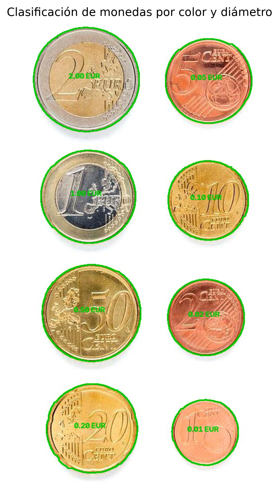


# Práctica 3 - Visión por Computador

Este repositorio contiene la tercera práctica de la asignatura Visión por Computador. En esta práctica se trabaja con Python, OpenCV, NumPy y Matplotlib para detectar objetos, analizar sus características geométricas y clasificarlos a partir de imágenes.

Las tareas planteadas consisten en identificar monedas y calcular su valor total, así como desarrollar un clasificador de partículas de microplásticos utilizando características geométricas y visuales, sin emplear modelos de aprendizaje profundo.

## Autores

- [Pablo Llopis Parrilla](https://github.com/Putrici0)
- [David González Espino](https://github.com/002avid)

## Contenido del repositorio

- `VC_P3.ipynb`: cuaderno principal donde se desarrolla la práctica y se encuentran las distintas tareas realizadas.
- `imagenes/monedas/`: imágenes utilizadas en la detección y clasificación de monedas.
- `imagenes/microplasticos/`: imágenes de prueba y referencia para microplásticos.
- `datos/`: CSV con las anotaciones de las imágenes de microplásticos.

## Instalación y ejecución

No se necesita instalar nada adicional respecto al entorno indicado en el [README de la práctica original proporcionada por el profesor](https://github.com/otsedom/otsedom.github.io/blob/main/VC/P3/README.md). Con ese entorno es suficiente para ejecutar el cuaderno `VC_P3.ipynb`.

Para la tarea de detección de monedas en tiempo real, el equipo debe disponer de una webcam y tener habilitados los permisos necesarios para acceder a ella.

## TAREA 1: detección y clasificación de monedas

El objetivo de esta tarea es **detectar monedas de euro, reconocer su valor y calcular el importe total** utilizando técnicas de visión por computador. Hemos desarrollado dos versiones: una sobre una imagen fija y otra que procesa los fotogramas de una webcam en tiempo real. Ambas utilizan OpenCV y características geométricas, sin recurrir a modelos de aprendizaje profundo. La versión de imagen fija también utiliza el análisis del color para mejorar la clasificación.

### 1. Detección en una imagen fija

Trabajamos con `imagenes/monedas/Monedas.jpg`. Primero convertimos la imagen a escala de grises y aplicamos un filtro gaussiano para suavizar pequeñas variaciones. Después, **Canny** detecta los bordes y un **cierre morfológico** conecta pequeños huecos. Finalmente, `findContours()` obtiene los contornos externos.

```python
gris = cv2.cvtColor(img, cv2.COLOR_BGR2GRAY)
suave = cv2.GaussianBlur(gris, (5, 5), 0)
bordes = cv2.Canny(suave, 50, 150)
kernel = np.ones((5, 5), np.uint8)
bordes = cv2.morphologyEx(bordes, cv2.MORPH_CLOSE, kernel, iterations=2)
contornos, _ = cv2.findContours(bordes, cv2.RETR_EXTERNAL, cv2.CHAIN_APPROX_SIMPLE)
```

No todos los contornos detectados son monedas. Descartamos los que tengan un área inferior al **0,02 %** o superior al **20 %** del área de la imagen, así como los que tengan perímetro nulo. También comprobamos su **circularidad**, calculada como `4 * π * área / perímetro²`. Aceptamos valores a partir de `0.65`.

Para cada contorno válido, `cv2.minEnclosingCircle()` calcula el círculo mínimo que lo contiene. Su radio permite estimar el diámetro de la moneda en píxeles.

#### Calibración

Para convertir los diámetros medidos en píxeles a milímetros, seleccionamos interactivamente una de las monedas detectadas e introducimos su denominación. El programa utiliza los diámetros oficiales de las monedas de euro para calcular la escala:

```python
mm_por_pixel = diametros_euro[valor_ref] / diametro_ref
```

La escala obtenida permite estimar el diámetro real de las demás monedas de la imagen. La calibración depende de que las monedas estén aproximadamente en el mismo plano y a una distancia similar de la cámara o de la imagen de referencia.

#### Clasificación por color y diámetro

La clasificación combina **color y tamaño**. Convertimos la imagen a HSV y analizamos los píxeles interiores de cada contorno, descartando los brillos extremos. A partir de las proporciones de tonos cobrizos, dorados y poco saturados, el programa distingue tres familias:

- **Cobre:** monedas de 1, 2 y 5 céntimos.
- **Dorado:** monedas de 10, 20 y 50 céntimos.
- **Bimetálicas:** monedas de 1 y 2 euros.

Una vez identificada la familia, se compara el diámetro estimado con los diámetros oficiales de las denominaciones de esa familia. Se elige la denominación con menor diferencia respecto al diámetro estimado. Si no se identifica una familia válida o el error supera **1,5 mm**, la moneda se marca como **dudosa** y no se suma al total.

**Resultado sobre la imagen fija:**



### 2. Detección de monedas en tiempo real

Adaptamos el procesamiento para que se repita continuamente con los fotogramas de la webcam, de forma que el importe mostrado cambie al introducir o retirar monedas. La cámara se abre con `cv2.VideoCapture(0)`.

En cada fotograma, convertimos la imagen a escala de grises, aplicamos Canny con umbrales de 25 y 120, cerramos pequeños huecos mediante una operación morfológica y obtenemos los contornos externos. Después aplicamos los filtros de área y circularidad. En esta versión, la circularidad mínima es `0.70` y se requieren al menos cinco puntos en el contorno antes de calcular el círculo mínimo.

#### Calibración interactiva

Antes de clasificar, el programa muestra los contornos candidatos numerados. El usuario pulsa una tecla del **1 al 9** para seleccionar una moneda de referencia e introduce su denominación en la consola. Con el diámetro detectado y el diámetro oficial se calcula la escala en milímetros por píxel.

Para que la estimación sea fiable, las monedas deben estar aproximadamente a la misma distancia de la cámara que la moneda de referencia. Si cambia la distancia, es necesario recalibrar.

#### Clasificación por diámetro

A diferencia de la versión de imagen fija, la versión de webcam **clasifica únicamente por diámetro**. Para cada candidato, convierte el diámetro detectado a milímetros y lo compara con los diámetros oficiales de las ocho denominaciones de euro. Se selecciona la denominación con menor error y se acepta si la diferencia es igual o inferior a **1,5 mm**.

Las monedas clasificadas se muestran con el contorno verde y su valor. El importe se vuelve a calcular en cada fotograma, por lo que representa **el valor estimado de las monedas visibles en ese momento**, no una suma acumulada.

Durante la ejecución se pueden utilizar estos controles:

- **1–9:** seleccionar la moneda de referencia cuando no hay calibración.
- **C:** eliminar la calibración anterior y realizarla de nuevo.
- **ESC:** salir del programa, liberar la cámara y cerrar las ventanas.

**Resultado sobre la imagen en tiempo real:**


**RESULTADO FINAL**
Candidatos detectados: 8
Monedas clasificadas: 8
Monedas dudosas: 0
Valor total estimado: 3.88 €

### 3. Limitaciones

El resultado depende de la iluminación, los reflejos y la calidad de los contornos. Las monedas solapadas pueden detectarse como un único objeto y los colores pueden variar con la luz. Además, si cambia la distancia a la cámara después de calibrar, la conversión de píxeles a milímetros deja de ser fiable.

La versión de imagen fija combina color y diámetro, mientras que la versión en tiempo real utiliza solo el diámetro. Por ello, en la webcam pueden confundirse denominaciones de tamaños parecidos, especialmente cuando existe error de calibración. También pueden aparecer falsas detecciones si otros objetos tienen una forma suficientemente circular.


## TAREA: clasificación de microplásticos

Esta tarea consiste en desarrollar un clasificador capaz de distinguir entre tres tipos de partículas: fragmentos (FRA), pellets (PEL) y alquitrán (TAR).

La clasificación debe realizarse mediante características geométricas y/o visuales, sin utilizar modelos de aprendizaje profundo. Para evaluar el clasificador se proporciona una imagen de prueba con sus correspondientes anotaciones, que permitirá calcular distintas métricas y generar una matriz de confusión.

*Pendiente de documentar la implementación.*

### Resultado

*Pendiente de incorporar los resultados, las métricas de evaluación y la matriz de confusión.*

## Fuentes y herramientas utilizadas

- Repositorio completo de la práctica proporcionado por el profesor, usado como enunciado y referencia principal: https://github.com/otsedom/otsedom.github.io/tree/main/VC/P3
- ChatGPT, usado como apoyo para resumir la documentación sobre OpenCV, NumPy y Matplotlib durante el desarrollo de la práctica: https://chatgpt.com/
